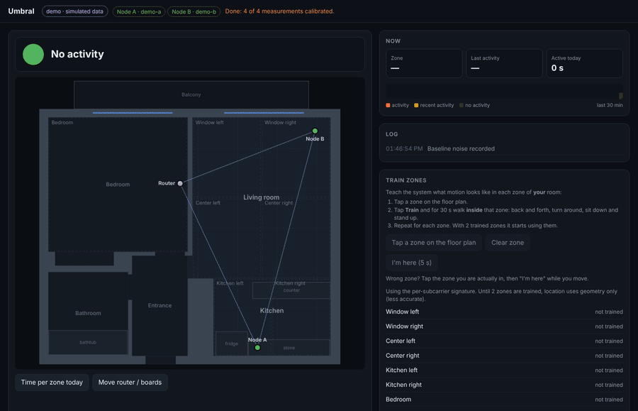

# Umbral

**Detect people at home using only WiFi signals.** No cameras, no microphones, no wearables — two cheap ESP32 boards and the router you already have.

Umbral reads the *Channel State Information* (CSI) of WiFi packets: how each of the 64 OFDM subcarriers arrives at the receiver. A human body reflects and absorbs 2.4 GHz radio, so when someone moves, the CSI changes. Umbral turns those changes into **activity detection** and an estimate of **which zone of the room** the person is in, shown live on a floor plan of the apartment.

**▶ [Live demo with simulated data](https://santistc.github.io/umbral/)** — runs in the browser, no hardware needed.



> Inspired by [RuView](https://github.com/ruvnet/RuView), which needs ESP32-S3 boards. Umbral was built from scratch for the **original ESP32** (the cheapest, most common one) and for a real, imperfect apartment: router on the floor behind a wall, a TV, a fridge, an open window.

---

## How it works

```
         router (in the bedroom, on the floor)
          │  ╲
   ping   │    ╲  ping                Each board measures 2 links:
 traffic  │      ╲                      · router → board
          ▼        ▼                    · other board → board (ESP-NOW, 50 Hz)
     ┌─────────┐  ESP-NOW  ┌─────────┐
     │ Node A  │◄─────────►│ Node B  │  = 3 sensing lines across the living room
     │ ESP32   │           │ ESP32   │
     └────┬────┘           └────┬────┘
          │  HTTP /data (JSON, 5 Hz)
          ▼
   ┌───────────────────────────────────────────────┐
   │ Web panel (browser)                           │
   │  motion per line → state machine → zone       │
   │  zone = kNN / small neural net trained by you │
   └───────────────────────────────────────────────┘
```

1. **Firmware (C, ESP-IDF)** — each node pings the other to generate traffic that leaves the router's antenna, receives ESP-NOW beacons from the other node, and captures CSI for both links. Every 100 ms it computes motion metrics over a 0.5 s window and a **per-subcarrier motion signature**, and serves them as JSON.
2. **Detection (browser)** — a line is "active" when its motion exceeds the calibrated noise floor for several consecutive readings (isolated spikes are rejected). The panel reports only what it measures: *activity now*, *recent activity*, or *no activity*.
3. **Localization (browser)** — you walk for 30 s inside each zone; the panel learns what the 4 × 32 signature looks like there. Live readings are classified with **k-nearest neighbours** or a **small neural network trained in the browser** (pure JS, no libraries). An *"I'm here"* button adds corrections where it gets it wrong, and zones it cannot tell apart can be merged.

Details: [docs/ARCHITECTURE.md](docs/ARCHITECTURE.md).

## What it can and can't do

| ✅ Works well | ⚠️ Limits |
|---|---|
| Detecting movement near the sensing lines | A person sitting **perfectly still** is invisible to motion sensing |
| Ignoring furniture that was moved (it stays still) | Zone accuracy is bounded by having only 3 lines |
| Zone estimate after training (6–7 zones) | Areas far from every line are weakly covered |
| Running on low-cost boards (a few dollars each) | Wind moving things near a window looks like activity |

These limits, and the approaches that were tried and discarded, are documented in [docs/FINDINGS.md](docs/FINDINGS.md).

## Hardware

- 2 × ESP32 (original, not S3). Tested with a NodeMCU ESP-32S and an ESP32-2432S028 ("Cheap Yellow Display").
- Any 2.4 GHz router.
- USB chargers that can supply enough current (brownouts were a real problem).

## Quick start

1. **Flash** both boards (from Chrome, no toolchain needed) — see [docs/SETUP.md](docs/SETUP.md).
2. **Configure WiFi** with [`tools/configure-board.html`](tools/configure-board.html): it talks to the board over Web Serial; the password is stored on the board, never in a file.
3. **Open the panel** at `http://<board-ip>/` (or open `web/index.html` locally), record the background noise with the room empty, and train the zones.

Build from source:

```bash
cd firmware
idf.py set-target esp32
idf.py build flash monitor     # ESP-IDF v5.4
```

## Repository layout

```
firmware/   ESP-IDF project (C) — CSI capture, metrics, ESP-NOW, HTTP API
web/        The panel: single HTML file, embedded into the firmware and deployed as the demo
tools/      Board configuration page (Web Serial)
docs/       Architecture, setup, findings
```

## Acknowledgements

- [espressif/esp-csi](https://github.com/espressif/esp-csi) — CSI capture examples (Apache-2.0), see [NOTICE](NOTICE).
- [RuView](https://github.com/ruvnet/RuView) — the project that started the idea.

## License

[MIT](LICENSE)
